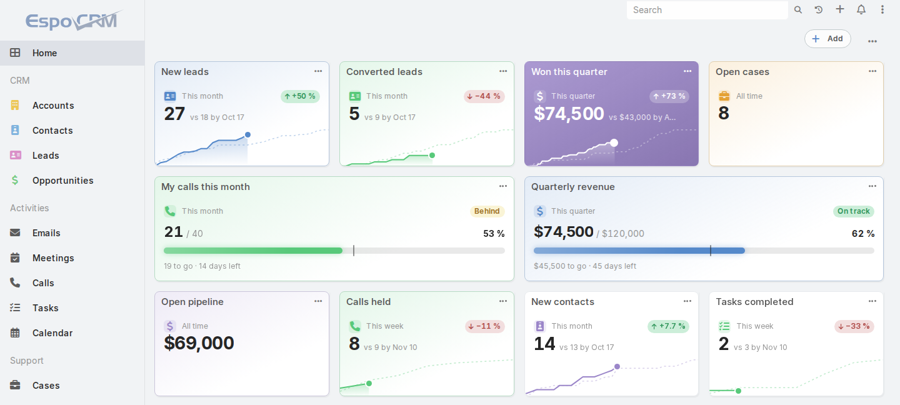
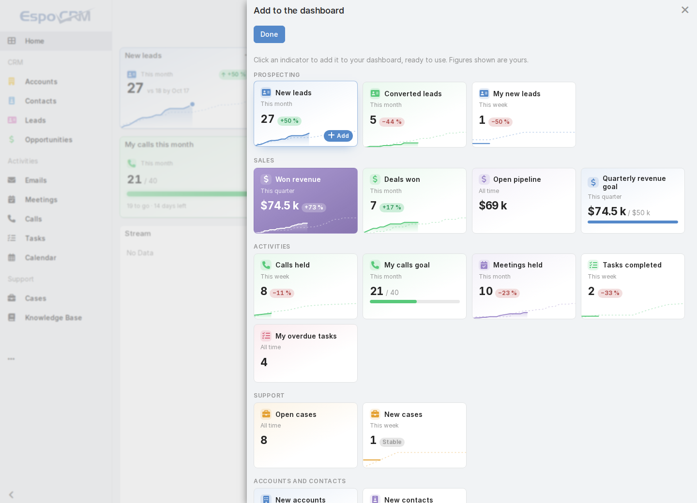
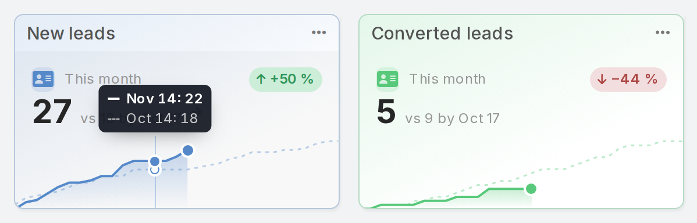
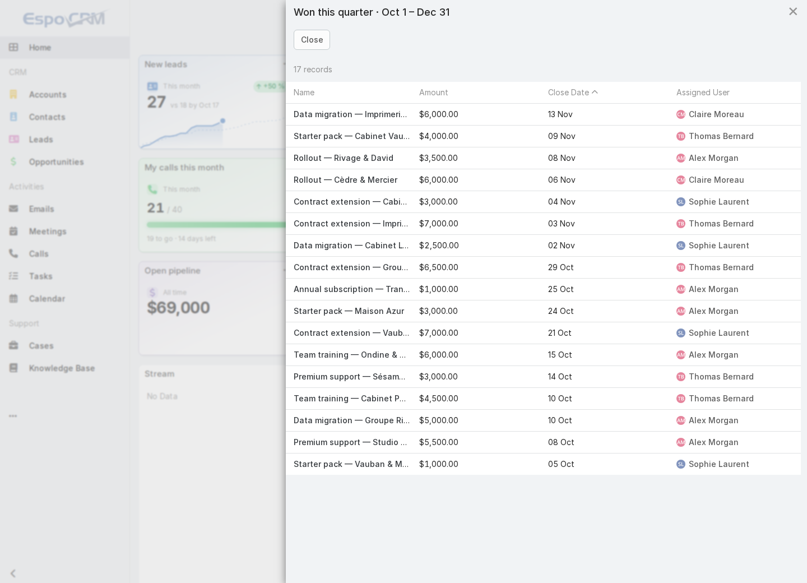
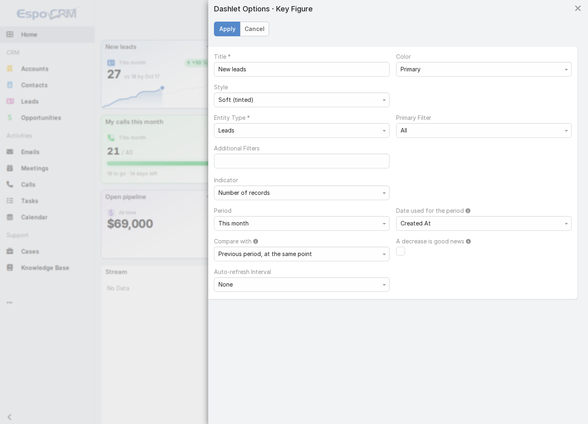
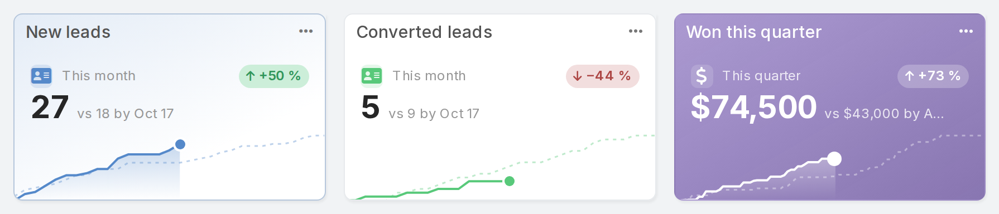
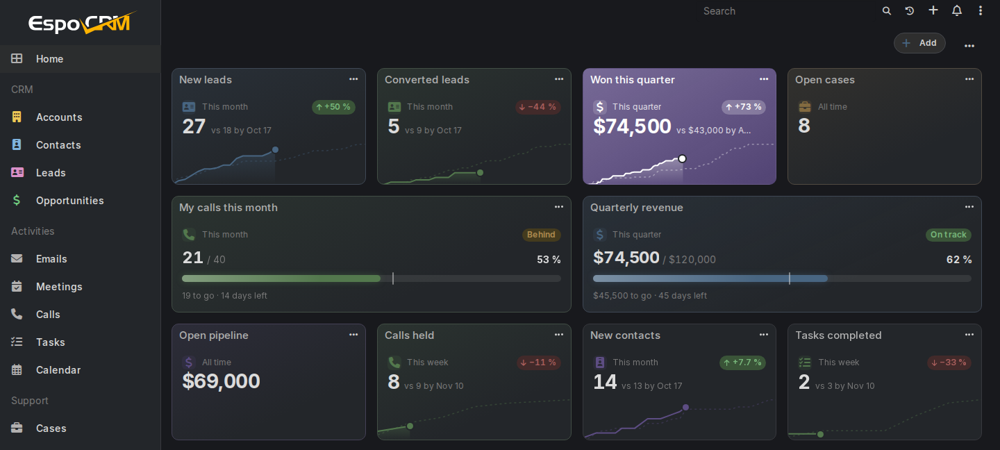

# Live Dashlets for EspoCRM

**Key figures and goals that bring the EspoCRM dashboard to life.** Each tile shows a trend, a curve and the records behind it, and you add them in one click. Every figure respects the access rights of the person looking at it.

[](LICENSE)




## Why Live Dashlets

Out of the box, EspoCRM dashboards offer record lists, the stream, a calendar and four charts that only cover opportunities. There is no "how many leads this month, and is that better than last month?" tile, and no goal tracking, unless you write reports or code.

Live Dashlets adds two dashlet types, **Key Figure** and **Goal**, which you configure in their options without writing code. It also makes the dashboard quicker to fill: a gallery of 16 ready-made indicators shows your real figures before you add them.

- **One click to add.** A visible "+ Add" button opens a gallery of ready-made indicators with live previews. A click puts the indicator on the dashboard, already set up.
- **Figures that tell a story.** Each figure shows its change against the same point of the previous period, as a badge and as a cumulative curve.
- **One click to drill down.** Clicking a tile lists the records behind the figure.
- **Same permissions as everywhere else.** Two people can see different numbers on the same tile, because each one only counts the records they are allowed to read.

## Features

### A gallery of ready-made indicators

Click **+ Add** on the dashboard, or **Add Dashlet** in its menu. The gallery shows 16 indicators in five groups: Prospecting, Sales, Activities, Support, and Accounts and contacts. Each card already shows your figure, its trend and its curve. One click adds the indicator to the top of the dashboard, titled in your language; add as many as you like, then click **Done**.

New tiles line up from left to right after the small tiles at the top of the dashboard. A tall dashlet in the way (a stream, a list) moves down one row. The gallery only offers indicators on data you can read. Its **Build your own** section adds an empty Key Figure or Goal, and links to the full list of EspoCRM dashlets.



### Key Figure

A large number with the entity icon, the period and the change against the previous period, for example "27 new leads this month, +50 %, vs 18 by Oct 17".

- **A fair comparison.** By default, the previous period is cut at the same point: on November 17, this month is compared with October 1 to 17. You can also compare with the whole previous period, or turn the comparison off.
- **The curve of the period.** It shows the cumulative value day by day: the current period as a solid line, the previous one dashed. Hover the curve to read both values on a given day.
- **When a decrease is good news.** The option of that name turns falling figures green, for things you want to see go down, such as open cases or overdue tasks.



### Goal

A progress bar toward a target, with:
- a marker showing where you should be at this point of the period;
- a status: **On track**, **Behind** or **Reached**;
- what is left to do and the number of days left.

### The records behind a figure

Click a tile, or press Enter when it has focus, to list the records it counts. The list uses the same filters and period, and the standard list API, so the same permissions. It shows the name, the added-up amount, the date that places the record in the period, and the assigned user, most recent first.



### Options without code

| Option | What it does |
|---|---|
| Entity | Any entity you can read, custom entities included |
| Primary filter and additional filters | The entity's own filters, such as "Won", "Open", "Held" or "Only my" |
| Indicator | Number of records, or the sum or average of a number or currency field |
| Period | Today, this week, month, quarter or year, the fiscal quarter or year, the last 7 or 30 days, or all time |
| Date used for the period | Which date places a record in the period: created at, close date, converted at… |
| Compare with | The previous period at the same point, the whole previous period, or nothing |
| Target | For a Goal |
| Color and style | Six theme colors, three styles |
| Auto-refresh | Every 30 seconds up to every 10 minutes |



### Three styles

**Soft** (the default) tints the whole tile with its color. **Minimal** stays neutral. **Solid** fills the tile with color: keep it for one headline figure per dashboard.



Colors come from the active theme, so tiles follow light and dark themes. The layout adapts to the height of the tile, which varies from one theme to another.



### A ready-made dashboard template

Installing the extension creates a **Live dashboard** template in **Administration → Dashboard Templates**. It contains:
- new and converted leads this month;
- the amount won this quarter, as the one solid tile;
- open cases;
- two goals, "My calls this month" and "Quarterly revenue";
- the stream and tasks.

Adjust the targets, then deploy it to the users or teams you choose. Nothing is imposed on anyone.

### Details that matter

- **Animations.** Figures count up, curves draw themselves, bars fill in, and a reached goal gets a light sweep. Nothing moves when the system asks for reduced motion.
- **Time zones and calendars.** Periods follow each user's time zone and first day of the week, and the fiscal year setting.
- **Currencies.** Amounts are added up in the default currency, like EspoCRM's own charts, and displayed with the system's currency format and separators.
- **Languages.** English and French.

## Permissions and privacy

- The server checks read access to the entity and to every field used (the added-up field and the date field). Records are selected with EspoCRM's strict access control, the same as list views. A sales rep with "own" access only counts their own leads.
- The option lists and the gallery only offer entities and fields the user can read. A tile on an entity the user cannot read says so, without sending a request.
- Nothing leaves your EspoCRM: no external service, no tracking.

## Installation

1. Download `live-dashlets-1.0.0.zip` from the [latest release](../../releases/latest).
2. In EspoCRM, go to **Administration → Extensions**, upload the ZIP and click **Install**.
3. Optional: in **Administration → Dashboard Templates**, open **Live dashboard**, adjust the goal targets and deploy it.

Requirements: EspoCRM 10.0.3 or later, PHP 8.3 or later. Tested on EspoCRM 10.0.3 and 10.0.11.

To update, install the new ZIP over the old one. To uninstall, go to **Administration → Extensions**: the template is removed, and dashboards already deployed keep working (EspoCRM skips dashlets that no longer exist).

## Adding your own ready-made indicators

The gallery is defined in metadata, so you can add company-specific indicators without code, for example in `custom/Espo/Custom/Resources/metadata/app/liveDashlets.json`:

```json
{
    "presetList": [
        "__APPEND__",
        {
            "name": "bigDeals",
            "group": "sales",
            "dashlet": "LiveDashletsKpi",
            "width": 1,
            "height": 1,
            "options": {
                "entityType": "Opportunity",
                "primaryFilter": "won",
                "metric": "count",
                "dateField": "closeDate",
                "period": "currentQuarter",
                "comparison": "toDate",
                "accentColor": "success",
                "tileStyle": "soft"
            }
        }
    ]
}
```

Give it a title in `custom/Espo/Custom/Resources/i18n/en_US/LiveDashlets.json` (`{"presets": {"bigDeals": "Big deals"}}`), then clear the cache.

## How it works

- **Figures.** `GET LiveDashlets/metric` selects the ids of the readable records with EspoCRM's select builder (strict access control, primary and bool filters, period), then aggregates them with `COUNT`, `SUM` or `AVG` through `id IN (subquery)`. A join added by a filter therefore cannot count a record twice.
- **Curves.** With `series=true`, the endpoint also returns cumulative values per day, or per hour for "Today". They are grouped in SQL in the user's time zone.
- **Dashboard.** `clientDefs.Home.view` points the home page to a view that extends EspoCRM's dashboard and adds the gallery. If another extension also replaces the home dashboard view, only one of them can be active.
- **Records list.** The modal queries the standard list API with `primary`, `bool` and `between` where items. It passes the user's time zone explicitly, so the list matches the figure.
- **Packaging.** The front end ships as a bundle declared in `app/client.json`.

## Development

The project uses [espo-extension-tools](https://github.com/espocrm/extension-tools). Point the `site` symlink to an EspoCRM installation, then:

```bash
npm install
npm run sync          # copy src/ to the EspoCRM site
npm run clear-cache   # after a metadata change
npm run extension     # build build/live-dashlets-<version>.zip
```

### Demo data

The screenshots above were taken on EspoCRM 10.0.11 with data from `dev/demo-data.php`, about 1,200 records:
- accounts, contacts, leads and opportunities since April;
- calls, meetings, tasks and cases since August, plus planned calls and meetings for the next two weeks.

The data is shared among the active users and their teams, with activity that grows over time. Record names follow the system language (English or French). The records are created silently (no stream entries, no notifications) and marked "Demo data (Live Dashlets)." in their description, so that `dev/demo-data-remove.php` can delete them. Neither script is part of the ZIP.

```bash
# From the EspoCRM root, as the web server user. Use only on a test instance.
php demo-data.php [--seed=101] [--boost=1.25]
php demo-data-remove.php
```

## License

Copyright (C) 2026 Alexis SANTIN.

Live Dashlets is free software, released under the [GNU Affero General Public License v3.0 or later](LICENSE), the same license as EspoCRM.
